<!-- Suraj Kumar / GitHub profile • Visual assets hosted in my public HeySuraj repository. -->

<a href="https://heysuraj.com/">Portfolio</a> · <a href="https://lazyplex.com/">Lazy Plex</a> · <a href="https://digital.lazyplex.com/">Digital Lazy Plex</a> · <a href="https://www.linkedin.com/in/surajkumarmarketing/">LinkedIn</a>

### Selected work

| Project | What I'm building or exploring | Explore |
|:--|:--|:--|
| **Hey Suraj** | An interactive personal website, writing space and Pico companion | [Website](https://heysuraj.com/) · [Public source](https://github.com/surajsingh5803/heysuraj-website) |
| **Lazy Plex** | My independent digital strategy, marketing and systems venture | [Project note](https://heysuraj.com/projects/lazy-plex/) · [Digital work](https://digital.lazyplex.com/) |
| **LP CRM** | A modular CRM and business operations platform | [Project note](https://heysuraj.com/projects/lp-crm/) |
| **LP LeadOS** | Evidence-led prospect discovery and lead intelligence | [Project note](https://heysuraj.com/projects/lp-leados/) |
| **SEO Audit Engine** | Search and technical website intelligence tooling | [Project note](https://heysuraj.com/projects/seo-audit-engine/) |

Some LP software repositories are private or under active development. Project notes describe the work without claiming public source availability.

**A bit beyond code:** marketing experiments, business building, creative tools, gaming, and learning by shipping. 

<a href="https://heysuraj.com/">🌐 Portfolio</a> &nbsp;·&nbsp;
<a href="https://www.linkedin.com/in/surajkumarmarketing/">💼 LinkedIn</a> &nbsp;·&nbsp;
<a href="https://www.instagram.com/the.surajsingh/">📸 Instagram</a> &nbsp;·&nbsp;
<a href="https://github.com/surajsingh5803">⌘ GitHub</a> &nbsp;·&nbsp;
<a href="https://digital.lazyplex.com/">↗ Digital Lazy Plex</a>

Designed for humans. Built with curiosity. © 2026 Suraj Kumar.

